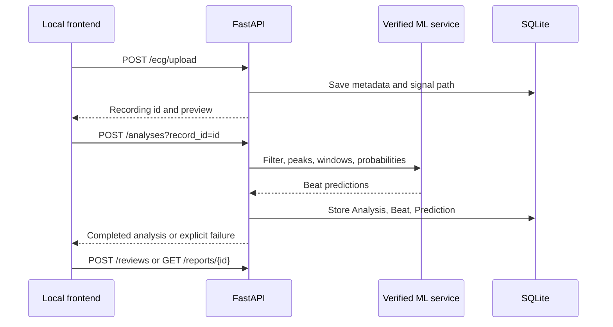

# Local API

Base path: `/api`. The earlier routes also remain under `/api/v1` (`/model-info` was removed). The service listens on `127.0.0.1:8000` by default. FastAPI's generated schema is available at `/docs` while the local API runs. JSON error bodies use `detail`; uploads and rate/lead issues use 4xx responses.

## Endpoints

| Method | Path | Purpose |
|---|---|---|
| GET | `/health` | API and model-load status |
| POST | `/ecg/upload` | Multipart CSV or WFDB upload; returns metadata and downsampled signal preview |
| GET | `/ecg/records` | Locally stored recordings |
| POST | `/analyses?record_id=…` | Run a retrospective analysis synchronously |
| GET | `/analyses` | Recent analyses |
| GET | `/analyses/{id}` | Status, provenance and aggregate beat counts |
| DELETE | `/analyses/{id}` | Delete an analysis and its beat predictions, explanations, reviews, report rows, and generated report files; preserves the uploaded recording |
| GET | `/analyses/{id}/beats?offset=0&limit=1000` | Beat-level predictions and latest review |
| GET | `/analyses/{id}/signal?start_sample=0&count=1200&filtered=false` | Actual uploaded ECG samples and time coordinates |
| GET | `/analyses/{id}/explanations?beat=…&class=N&method=gradcam` | Compute/cache a real model attribution |
| GET | `/reviews` | Saved reviews, optionally filter by status/analysis_id |
| POST | `/reviews` | Save a separate human label and note |
| GET | `/reports/{analysis_id}?format=pdf` | Generate/download a PDF |
| GET | `/reports/{analysis_id}?format=csv` | Generate/download beat-level CSV |
| GET | `/reports/{analysis_id}?sections=a,b&inline=true` | Choose sections: recording, preprocessing, waveform, distribution, predictions, xai, notes, performance, limitations |
| GET | `/status`, `/overview`, `/history` | System status, stored counts and activity, all analyses with review state |
| POST | `/upload`, `/analyze?record_id=…` | Upload; start a background analysis (poll `/analyses/{id}`, `summary.stage`) |
| GET | `/recordings`, `/recordings/{id}` (+ `/signal`, `/envelope`, `/window`, `/quality`, `/predictions`, `/explanations`) | Recording-centred reads |
| GET | `/analyses/{id}/reference`, `/analyses/{id}/explanations/compare` | Reference labels from the uploaded annotation; Grad-CAM/IG rank agreement |
| GET, POST | `/analyses/{id}/sign-offs` | Append-only analysis-level review state |
| GET | `/model/config`, `/model/metrics`, `/model/xai-evaluation` | Loaded model facts and evaluation artifacts |
| GET | `/study`, `/study/operating-points` | Multi-database study artifacts; smoke runs are refused |
| GET | `/dataset/summary`, `/dataset/records`, `/dataset/representatives`, `/dataset/records/{r}/segment`, `/dataset/records/{r}/window` | Dataset Explorer |
| GET | `/demo/samples`, `/demo/samples/{id}`, `/demo/samples/{id}/gradcam`, `/demo/challenge` | Labelled training/validation windows only |

## Upload fields

For CSV, submit `files` (one CSV), `sampling_rate` and `lead` (the selected column). WFDB uploads submit a `.hea`, matching `.dat`, and optionally a matching `.atr`; all three base names must be identical and the `.hea` record identifier must match its filename. The WFDB sampling rate and available lead names are read from the header. If AAMI-mapped annotation peaks exist, upload and analysis compare them one-to-one with XQRS peaks. By default at least 90% of annotation peaks must match within 150 ms. Configure with `NEUROCARDIO_ANNOTATION_ALIGNMENT_MIN` (fraction from 0 to 1) and `NEUROCARDIO_ANNOTATION_ALIGNMENT_TOLERANCE_MS` (positive milliseconds). A failed alignment is a 422 response and the annotation is not used. The current selected model accepts exactly 360 Hz. Other rates are rejected, not resampled. The configured byte cap is 64 MiB. Signal values must be finite and non-flat, the file must support at least one full 720-sample beat window, and a peak must be detected during upload validation.

## Analysis behavior

An included annotation file is used as the peak source when it contains AAMI-mapped beat annotations and passes the XQRS alignment check; this is recorded as `wfdb_annotation`. Otherwise the service uses WFDB XQRS. Analysis is retrospective. Edge windows are skipped and counted. The JSON summary reports class counts, S+V+F beat count, review flags, peak source and uncertainty-policy provenance. It intentionally does not assign a recording-level rhythm diagnosis. Beat API indices remain zero-based; the UI displays one-based beat numbers.

`POST /analyses` runs synchronously; `POST /analyze` runs in a background thread, one job at a time, and stores the current stage. There is no persistent job queue: a job interrupted by a restart is marked failed. WFDB uploads whose annotation file contains paced-beat symbols are rejected. A non-MLII lead or a missing annotation file produces an `input_warnings` entry. Beat indices in API responses remain zero-based. The frontend displays `beat_index + 1`; its explanation request passes the selected beat's API identifier and does not submit the display number.

## API workflow

The frontend origin is restricted to local Vite at `http://localhost:5173`. This prototype has no authentication; do not expose its API to a network.
