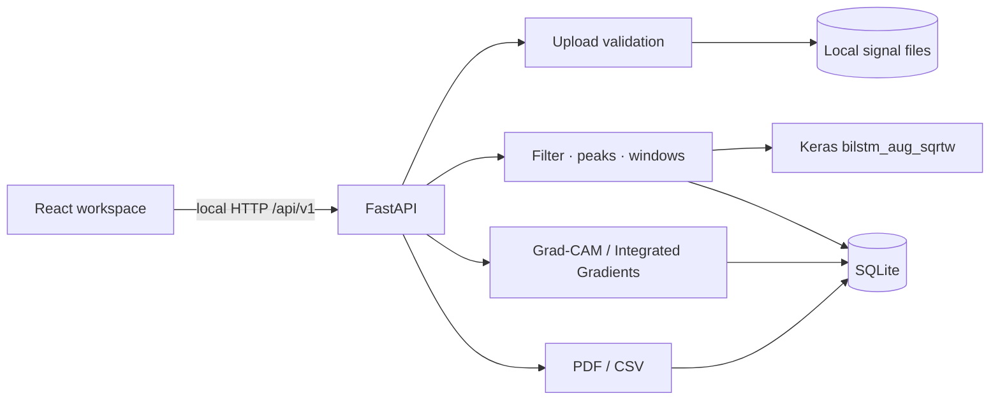
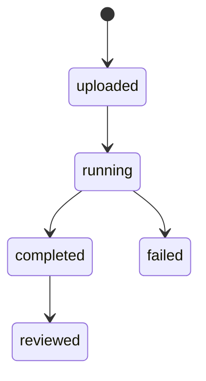
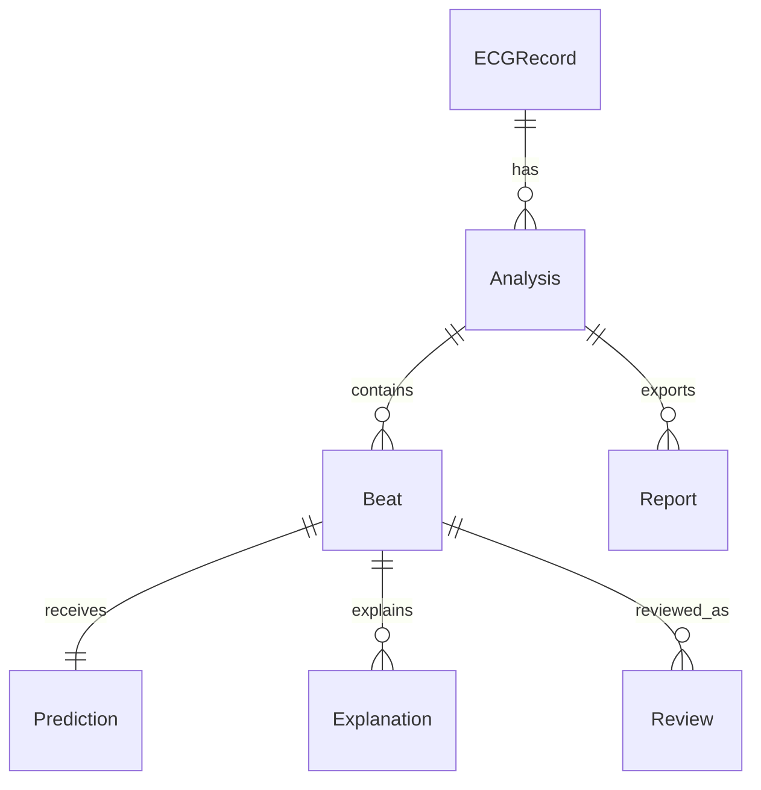

# Architecture

NeuroCardio is a local research application. The frontend calls a FastAPI service, which validates signals, applies the verified single-lead pipeline, invokes the loaded Keras model, and persists analysis outputs in SQLite.

The application creates `backend/data/` on startup. Signal arrays, WFDB companion files, reports, and the SQLite database remain there. Model, preprocessing config, and evaluation evidence are read locally from `backend/models/` and `results/`.

## Analysis lifecycle

Analyses record the model hash, config hash, and preprocessing version. Predictions and human reviews are separate tables; a review cannot overwrite the stored prediction.

## Entity relationships

`Analysis` stores status, provenance, progress, skipped-edge count, and aggregate beat-class counts. `Beat` stores original sample positions and timestamps. `Prediction` stores the four raw class probabilities, prediction, confidence, margin, and exploratory review flag. `Review` stores the original predicted class alongside the reviewed label, note, reviewer and timestamp.
